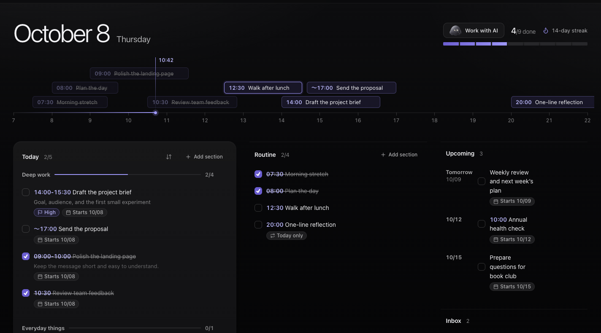
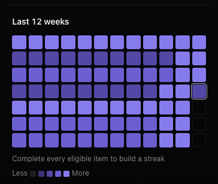
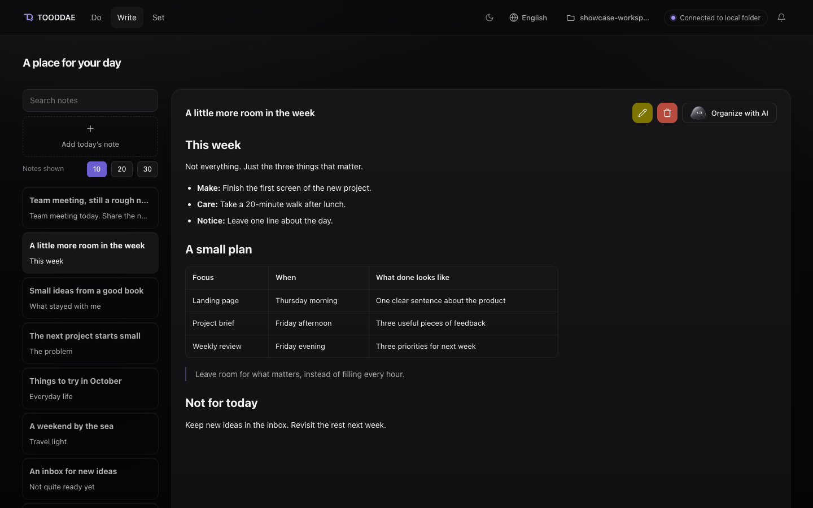
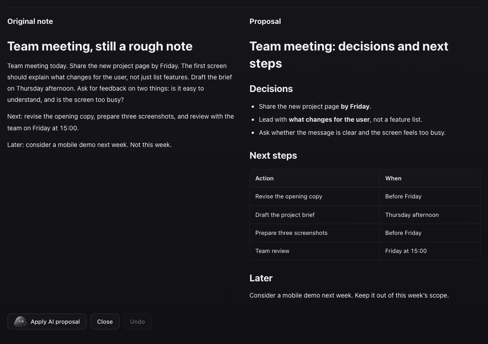
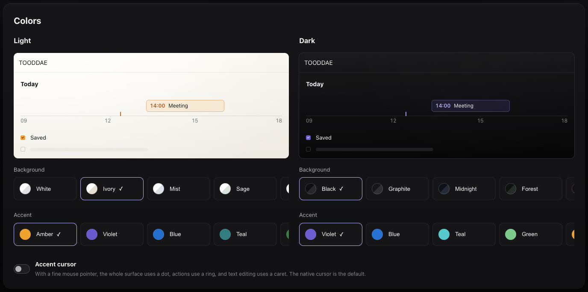
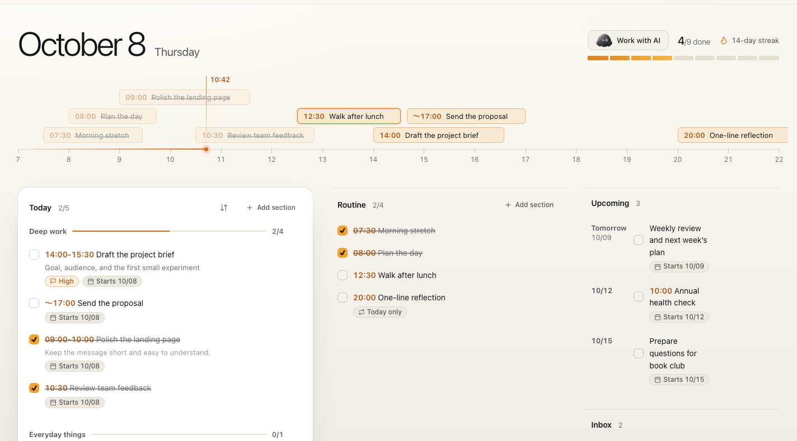

<div align="center">

<picture>
  <source media="(prefers-reduced-motion: reduce)" srcset="../docs/assets/readme/highsoul-hidden.png">
  <source type="image/webp" srcset="../docs/assets/readme/highsoul-idle.webp">
  
</picture>

# TOODDAE

### 一日に、もう少し余白を。

タスク、時間、ノートを、自分で管理するフォルダーに。

[はじめに](#はじめに) · [できること](#できること) · [自分のファイル](#ファイルは自分の手元に)



</div>

**TOODDAE は、計画し、実行し、記録するためのローカルファーストな個人用ワークスペースです。** タスクを一日の時間に配置し、ルーティンを身近に置き、その前後の考えを通常の Markdown ファイルに残せます。

[한국어](README.ko.md) · [日本語](README.ja.md) · [English](../README.md) · [简体中文](README.zh.md)

> 画像は、英語のインターフェースに架空のデモデータを入れて撮影した実際のアプリ画面です。AI の比較画面には、確認と適用の流れを示すためのローカルな応答例を使っています。実際のモデルによる生成結果ではありません。新しいワークスペースに、これらのサンプル記録は含まれません。

---

<a id="これを試してみてください"></a>

## 🤖 これを試してみてください

ローカルでの起動に慣れていなくても、AI エージェントにセットアップを頼めます。下を開いてプロンプトをコピーし、自分のパソコンでターミナルのコマンドを実行できるエージェントに貼り付けてください。

<details>
<summary>📋 セットアップ用プロンプトを開いてコピーする</summary>

```text
私のパソコンに TOODDAE を安全にセットアップし、起動するのを手伝ってください。
リポジトリ: https://github.com/highsoul-studio/TOODDAE

1. まず、私のローカルのパソコンを操作できる環境か確認してください。
   クラウドやリモートの環境しか使えない場合は、そこにインストールせず、
   制約と私が行う手順を案内してください。私のパソコンで
   起動したとは言わないでください。
2. OS と Node.js のバージョンを確認してください。Node.js 20 以降が必要です。
   未導入または古い場合は、OS に合う公式のインストール方法を案内し、
   インストールやシステム変更の前に私の確認を得てください。
3. 新しい独立したインストール先フォルダーを選んでください。
   既存のファイルやノートを上書き・初期化・削除しないでください。
   同名のフォルダーがある場合は、変更前に聞くか別の新しい場所を使ってください。
4. そこにリポジトリをクローンしてください。Git がない場合は、
   アクセスを許可されたソースのダウンロード方法を使ってください。
   ログインや権限が必要なら、私がすべきことを説明してください。
   アクセス制限を回避したり、パスワードやトークンをチャットに求めたりしないでください。
5. 最新の README とプロジェクトの指示を読み、リポジトリのルートから
   次の手順を、最後まで実行が終わる通常のコマンドとして実行してください。
   サーバーを止まらないフォアグラウンドのコマンドで握り続けないでください。
   - macOS（推奨）: cd Dayline && npm run app:package
     リポジトリのルートに TOODDAE.app が作られます。続けてアプリを開いて
     ください（例: Dayline/ からの相対で open ../TOODDAE.app）。
   - その他の OS（アプリランチャーは macOS 専用）: node scripts/start-demo.mjs --detach
     を実行してください。サーバーをバックグラウンドで起動し、URL と PID を
     表示してすぐ終了します。出力を受け取る状態で単に & を付けて起動しないで
     ください（サーバーが出力パイプを握り続け、コマンドが終わりません）。
     既定のポート 44318 が
     使用中なら DAYLINE_DEMO_PORT に空きポートを指定し、実際の URL を伝えてください。
   npm install は不要です。実行時の依存パッケージはありません。
   macOS が初回起動時に警告を出した場合（アプリは ad-hoc 署名で、Apple の公証は
   受けていません）は、アプリを右クリックして「開く」を選ぶよう案内してください。
   Gatekeeper を無効にしたり、セキュリティ設定を勝手に変更したりしないでください。
   既存ノートの接続、AI/API キーの設定、ログイン時の自動起動サービス、
   公開ウェブサイトへのデプロイは行わないでください。
6. http://127.0.0.1:44318 でアプリが実際に応答するか確認してください
   （例: /api/status へのリクエスト）。ブラウザーで確認するときは「ネットワーク
   アイドル」ではなく、画面に見える要素を待ってください。ページはライブ更新用の
   接続を 1 本開いたままにするため、アイドルになりません。
   ポートが使用中なら別のプロセスを
   停止せず、何が使っているか（ランチャーが別のコピーとその PID を示します）を
   私に伝えて確認してください。この方式ではポート 4317 を使わないでください。
7. インストール先のフォルダーと TOODDAE.app の場所を教えてください。
   アプリを「アプリケーション」フォルダへドラッグすれば通常のアプリのように
   使えますが、現在のこのフォルダーと Node.js の場所を引き続き使うことも
   説明してください。再び開く方法（開き直すとバックグラウンドのサーバーを
   再利用します）とサーバーを止める方法（アクティビティモニタ、または
   lsof -ti tcp:44318 -sTCP:LISTEN | xargs kill）を教えてください。
   確認できた結果と未確認の点を分け、問題があれば原因と次の手順を
   分かりやすく説明してください。
```

</details>

チャットだけの AI は案内できますが、あなたのパソコンでアプリを直接起動することはできません。自分でセットアップする場合は[はじめに](#はじめに)をご覧ください。

---

<a id="できること"></a>

## 🧭 できること

<a id="今日に集中しながら次の予定も見失わない"></a>

### 📅 今日に集中しながら、次の予定も見失わない

**Do** ページには、日々使う四つのビューがまとまっています。

- **今日のタスク:** セクションごとに作業を分け、優先度や短いメモを付け、終わったらチェックできます。
- **ルーティン:** 繰り返す習慣を今日のタスクと並べて管理できます。時刻や繰り返しのルールも個別に指定できます。
- **今後の予定:** 日付の決まったタスクを、今日の作業になる前に確認できます。
- **インボックス:** いつ取り組むか決める前に、アイデアや日付のないタスクを集めておけます。

**Day line** は、時刻を指定したタスクとルーティンを同じ一日のタイムラインに表示します。開始時刻、時間の範囲、または `〜17:00 提案書を送る` のように終了時刻だけの締め切りを使えます。

<a id="小さな一日の積み重ねを見る"></a>

### 📈 小さな一日の積み重ねを見る

**直近12週間**のグリッドで日ごとの完了度を確認し、今日の進捗も把握できます。完了目標に含まれる項目を毎日すべて終えると、連続記録が伸びます。将来が締め切りのタスクは、今日の基本的な完了目標には含まれません。



<a id="散らばったメモを自分のノートライブラリに"></a>

### 📝 散らばったメモを、自分のノートライブラリに

**Write** は、会議のメモ、アイデア、読書記録、振り返りに使えます。同じ日付に複数のノートを作り、タイトルと本文全体を検索し、編集画面と読みやすい Markdown プレビューを切り替えられます。



- ノートにタイトルを付け、詳しい内容を本文に残せます。
- 見出し、リスト、リンク、表を使って書けます。
- 編集内容は自動保存されます。**保存**を選ぶと閲覧画面に戻ります。
- 以前のバージョンを復元し、対応するノート削除操作を取り消せます。

<a id="まとまっていないメモを使いやすい記録に"></a>

### ✨ まとまっていないメモを、使いやすい記録に

**AIで整える**は、選択したノートを読みやすく整えた内容を提案します。<em>「決定事項、次の行動、後で検討する項目に分けてください。」</em>のような追加の指示も書けます。原文と提案を並べて確認し、保存したい場合に**AI提案を適用**を選びます。



**適用するかどうかは、自分で決められます。** 整理を明示的に実行し、送信先への同意と接続テストが完了した場合にだけ、選択したノートが送信されます。提案を生成するだけでは原文を上書きしません。モデルの結果には誤りが含まれることがあるため、適用前に確認してください。

Do ページには、対応するタスク・ルーティン・セクションの操作を自然言語で依頼する、範囲を限定したアシスタントもあります。Write のノート整理とは別の機能です。[AI ツールと制約](../docs/AI-TOOLS-AND-SKILLS.md)をご覧ください。

<a id="自分に合ったワークスペースにする"></a>

### 🎨 自分に合ったワークスペースにする

**Set** では、ライトモードとダークモードの背景色・アクセント色をそれぞれ選べます。ワークスペース全体を切り替える前に、プレビューで確認できます。日の出・日の入りに合わせたテーマ切り替え時刻の設定や、英語・韓国語・日本語・中国語のインターフェース選択もできます。



<details>
<summary>☀️ 同じ一日をライトモードで見る</summary>



</details>

---

<a id="はじめに"></a>

## 🚀 はじめに

**必要な環境:** Node.js **20 以降**とブラウザー。アプリの実行に必要な **npm 依存パッケージはありません。** 起動のために `npm install` を実行する必要はありません。

リポジトリをクローンするか、ソースをダウンロードして展開してください。

```bash
git clone https://github.com/highsoul-studio/TOODDAE.git
cd TOODDAE
node scripts/start-demo.mjs
```

**[http://127.0.0.1:44318](http://127.0.0.1:44318)** を開きます。ホスティングされたウェブサイトではなく、自分のパソコンで動くアプリです。ターミナルで **Ctrl+C** を押すと終了します。

初回起動時に、起動スクリプトは `runtime/default/` にノート用フォルダーを作り、`runtime/demo-home/` に端末設定を保存します。既存のノートを自動接続したり、ログイン時に起動するサービスをインストールしたりはしません。後から自分で選択したフォルダーは記憶されます。既存のノートを接続する前に、バックアップを取ってください。

<details open>
<summary>🍎 macOS: 通常のアプリのように TOODDAE を開く</summary>

リポジトリのルートから実行します。

```bash
cd Dayline
npm run app:package
```

Finder で、リポジトリのルートに生成された **TOODDAE.app** を開きます。一致するローカルのバックグラウンドサーバーを起動または再利用し、ブラウザーを開きます。 本物のアプリのように使うには、**TOODDAE.app** を **アプリケーション** フォルダへドラッグし、Launchpad や Spotlight から開いてください。生成時に記録したこのリポジトリのフォルダと Node.js を引き続き使うため、どちらも移動しないでください。

ローカル起動を便利にするランチャーであり、**単体で使えるインストーラーではありません。** Node.js は同梱せず、LaunchAgent やログイン項目も追加しません。生成時に記録した Node.js とワークスペースのパスが必要です。どちらかを移動した場合は再生成してください。macOS 専用です。

生成されるアプリはローカル利用向けの ad-hoc 署名のみで、Apple の公証は受けていません。初回に「Apple は悪意のあるソフトウェアが含まれていないことを確認できません」という警告が出た場合は、Finder でアプリを右クリックして **開く** を選ぶか、システム設定 → プライバシーとセキュリティで **このまま開く** を押して許可してください。

**もう一度開いても安全です。** ブラウザーのタブを閉じても、バックグラウンドのサーバーは動き続けます。**TOODDAE.app** をもう一度開くとそのサーバーを再利用し、「ポートが使用中」というメッセージは表示されません。このメッセージが出るのは、*別の*コピーまたはバージョンの TOODDAE がポート 44318 でまだ動いているときだけです。その場合は先にそれを終了してから（アクティビティモニタで `node` を検索するか、メッセージに表示された PID で `kill <PID>` を実行）、アプリをもう一度開いてください。バックグラウンドのサーバーを自分で止めるには `lsof -ti tcp:44318 -sTCP:LISTEN | xargs kill` を実行します。アプリのサーバーが動いている間は `node scripts/start-demo.mjs` を同時に実行しないでください。どちらもポート 44318 を使います。

</details>

<a id="任意-ai-接続"></a>

### 🔌 任意: AI 接続

基本的なタスク管理と文章作成には、AI やクラウドアカウントは不要です。

AI の支援を使う場合は、**Set** でプロバイダーとモデルを選び、接続を設定し、その送信先への同意を行ってから **AI 接続をテスト**を実行します。API キーによる接続は **OpenAI、Anthropic、Gemini、DeepSeek** に対応しています。プロバイダーの利用料金が発生する場合があります。

任意の機能として、ChatGPT サインインと Claude Code のサブスクリプション接続も含まれます。ただし、利用できるかどうかはアカウントと対応するローカル実行環境に依存します。機能が含まれているだけで、利用資格や実際のアカウントとの互換性が保証されるわけではありません。API キーとサブスクリプションの認証情報は、ノート用フォルダーの外に保存されます。

設定の範囲や検証の詳細は、[実装状況](../docs/IMPLEMENTATION-STATUS.md)をご覧ください。

---

<a id="ファイルは自分の手元に"></a>

## 📁 ファイルは自分の手元に

TOODDAE は、フォルダー内の Markdown ファイルを読み書きします。

```text
ノート用フォルダー/
├── Daily/              日々のタスクと、その日のルーティン
├── Templates/          今後の日に使うルーティンの定義
├── Write/              同じ日付の複数ノートを含む記録
├── Inbox.md            日付のないタスク
└── Set/                ワークスペース設定
```

- **ローカルファースト:** 自分のパソコンでアプリを実行し、使うフォルダーを選べます。
- **通常の Markdown:** Obsidian やほかの Markdown エディターでファイルを読み、編集できます。Obsidian プラグインは不要です。
- **双方向の編集:** アプリでの変更も、接続先ファイルでの編集も、同じデータを使います。
- **任意の外部 AI:** ローカル保存は、AI がローカルで動くという意味ではありません。AI リクエストを実行すると、許可された文脈が選択した接続先に送信されます。

パソコンに接続した同期フォルダーにノートを保存できますが、それだけで TOODDAE がホスティングサービスになったり、スマートフォンで動作したりするわけではありません。同梱のサーバーはループバックアクセスを使います。

---

<a id="プロジェクトの状態と開発"></a>

## 🛠️ プロジェクトの状態と開発

実行可能なアプリは、元のプロトタイプの名前を維持した `Dayline/` にあります。**主な開発環境は macOS です。** ブラウザーテストには Chromium とモバイル画面サイズのエミュレーションが含まれます。実機のスマートフォン、ほかのブラウザーエンジン、Windows/Linux のネイティブインストールは未検証です。

ユニットテストとローカル HTTP テストは、次のように実行できます。

```bash
cd Dayline
npm test
```

Playwright による検証は、別の開発用テスト環境を使い、専用の依存パッケージとブラウザーのインストールが必要です。アプリの起動には不要です。

- [機能一覧](../docs/FEATURE-INVENTORY.md)
- [実装状況と既知の制約](../docs/IMPLEMENTATION-STATUS.md)
- [AI ツール・権限・境界](../docs/AI-TOOLS-AND-SKILLS.md)
- [画面キャプチャの説明](../docs/README-SHOWCASE.md)
- [リリース](https://github.com/highsoul-studio/TOODDAE/releases)

実行可能なソースと、ビルド済みの配布パッケージの提供状況は別です。TOODDAE という名前は <strong>Too + ddae（때）</strong>を組み合わせ、タスク、時間、記録しておきたい瞬間を表しています。

---

<a id="ライセンス"></a>

## 📜 ライセンス

TOODDAE は独自の **[TOODDAE No-Sale License v1.0](../LICENSE)** を使います。OSI 承認のオープンソースライセンスではありません。

- 個人利用・業務利用、変更、無料での共有を許可します。
- アプリや変更版の販売、有料ホスティング・SaaS、有料バンドルやアクセス料金には、別途の書面による許可が必要です。
- 共有時はライセンスと該当する表示を保持し、変更を明示してください。変更したソースコードを公開する義務はありません。
- 独自に作成したノート・タスク・成果物は、TOODDAE を使ったという理由だけで、このライセンスの対象にはなりません。第三者の素材には、それぞれのライセンスが適用されます。

英語の LICENSE が正文であり、この項目は要約です。
